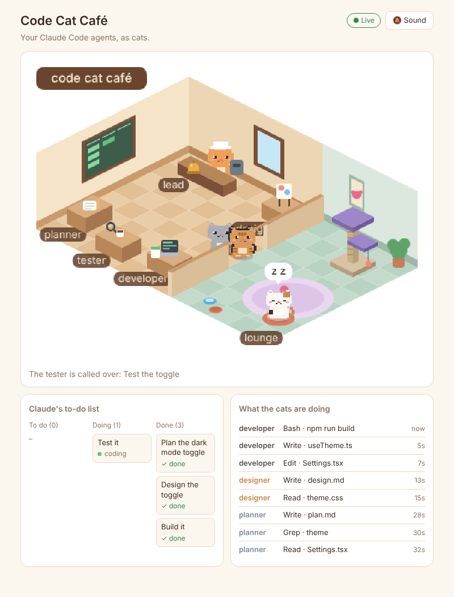

# Code Cat Office 🐱☕

A pixel cat office that shows your Claude Code agents at work.

Each Claude Code subagent is a cat with its own table. When a request comes in, the lead cat takes the order, the planner walks over to pick it up, then the designer, developer and tester each collect the ticket from the previous table, take it back to their own, and work on it. Cats with nothing to do wander around or go play in the lounge (cat tree, nap bed, food bowls, yarn ball).



**What it shows**

- **Who is working on what**, live: every tool call (Read, Edit, Bash, ...) appears above the cat doing it and in the activity list.
- **The bell 🔔**: when Claude Code needs your permission or is waiting for your reply, the lead cat rings the bell, a banner appears, the tab title flashes, and (if you turn sound on) it dings.
- **The order board**: Claude's to-do list (or your requests) in To do / Doing / Done, mirrored on the office's chalkboard.
- **Test failures**: when the tester reports FAIL, it carries the ticket back to the developer's table.

## Quick start

> New to this on a Mac? Follow the step-by-step guide: **[docs/SETUP-MAC.md](docs/SETUP-MAC.md)**

You need Node.js 20 or newer and Claude Code.

```bash
npx github:tfqnet/code-cat-cafe             # starts the office at http://localhost:4777
```

Connect a project (in a second terminal, from that project's folder):

```bash
npx github:tfqnet/code-cat-cafe setup       # hooks for the current folder
npx github:tfqnet/code-cat-cafe setup --global   # or for every project
```

Then **start a new Claude Code session** in the project (hooks load when a session starts) and ask for a feature. If nothing moves, run `npx github:tfqnet/code-cat-cafe doctor`: it says what is missing.

Want to see it move without Claude Code? Run `code-cat-office sample`, or open http://localhost:4777/?demo.

Prefer a clone? `git clone`, `npm install`, then `npm start` and `npm run setup -- ~/code/my-app`. `npm link` gives you the short `code-cat-office` command.

### Many projects, one office

One office serves all your connected projects. Every order, activity line and bell is tagged with its project name (the folder name), and a chip row under the title shows each project and lights up while it is active.

## How it works

```
Claude Code ──hooks──▶ bridge (localhost:4777) ──live events──▶ office page
```

1. **Hooks.** `npm run setup` adds [Claude Code hooks](https://code.claude.com/docs/en/hooks) to your project's `.claude/settings.local.json`. On each event (prompt sent, subagent started or stopped, tool used, permission needed, turn finished) Claude Code sends the event details to the bridge with `curl`. The hooks run in the background (`async`) and never block or change what Claude does.
2. **Bridge** (`bridge/`): a small Node server with no dependencies. It turns hook payloads into simple office events and streams them to the page. It only listens on `127.0.0.1`, so nothing leaves your machine.
3. **Office page** (`web/`): a canvas animation that acts out the events. Events go into a queue, so the story always plays in order even when Claude is faster than the cats.

### Which cat is which

The office maps each subagent name to a role by keywords:

| Subagent name contains | Cat |
| --- | --- |
| `plan`, `explore`, `research`, `architect` | planner (grey) |
| `design`, `ui`, `ux` | designer (calico) |
| `test`, `qa`, `review`, `verif` | tester (tabby) |
| anything else | developer (black) |
| no subagent (main Claude) | lead (orange, chef hat) |

The `team-kit/` folder has a ready-made team whose names match exactly. `npm run setup -- <project> --team` copies it into your project.

## Commands

| Command | What it does |
| --- | --- |
| `code-cat-office` | Start the office and open http://localhost:4777 (`--no-open`, `--port 4778`) |
| `code-cat-office setup [path]` | Add office hooks to a project (default: current folder) |
| `code-cat-office setup [path] --team` | Same, plus copy the agent team and `CLAUDE.md` |
| `code-cat-office setup --global` | Add office hooks for every project (`~/.claude/settings.json`) |
| `code-cat-office setup [path] --remove` | Take the office hooks out again (add `--global` for the global ones) |
| `code-cat-office doctor [path]` | Check Node, curl, the page, the server, the hooks and whether events arrive |
| `code-cat-office sample` | Play a sample session into the office (no Claude Code needed) |
| `npm run dev` | Development mode with hot reload (page on http://localhost:5173) |
| `npm test` | Bridge unit tests |

The `npm run setup`, `npm start`, `npm run sample` and `npm run doctor` scripts do the same from a clone.

Use a different port with `CAFE_PORT=4778 npm start`. The hooks read the same variable, so set it in your shell profile if you change it.

## Make it yours

- **Your own cat:** change the colours in `web/src/world.ts` (the `cats` section): `fur`, `belly`, `tail`, `eye`, plus optional `marks` for patches and stripes.
- **Layout:** desks, seats and lounge spots are also in `web/src/world.ts`.
- **Drawing:** everything is drawn in `web/src/render.ts`, with no image files.

## Platforms

- **macOS:** tested.
- **Linux:** should work as is (it needs `curl`, and `xdg-open` for the auto-open). Not tested.
- **Windows:** the hooks use `curl` and POSIX shell syntax, so run Claude Code from Git Bash or WSL. Not tested.

`doctor` checks for `curl` and tells you what is missing.

## Privacy and security

- The office listens only on `127.0.0.1`, so other machines cannot reach it. Do not set `CAFE_HOST` to anything else on a shared network.
- The page shows the first words of your prompts, tool names and file names. Nothing leaves your machine.
- There is no login: any program on your own machine can post events to the office (only fake cat activity, nothing more).
- Raw hook payloads are logged to `~/.code-cat-cafe/hook-events.jsonl` (rotated at 2 MB). Those include your prompts, so delete the file if you share your machine.

## Known limits

- Subagents that run **in parallel** are acted out one after another.
- An order is marked served when Claude finishes its turn, including when it stops to ask you a question.
- Hook payload fields vary a little between Claude Code versions. The bridge reads them defensively and logs every raw payload to `~/.code-cat-cafe/hook-events.jsonl`, which is the first place to look if a cat isn't reacting.

## Project layout

```
bin/         code-cat-office.js (the command line)
bridge/      server.js (hook receiver + live stream), normalize.js, setup-hooks.js, doctor.js, send-sample.js, tests
web/         index.html, src/ (world, director, render, feed, main)
team-kit/    CLAUDE.md + .claude/agents (planner, designer, developer, tester)
docs/        SETUP-MAC.md, screenshot
LICENSE, CHANGELOG.md
```
